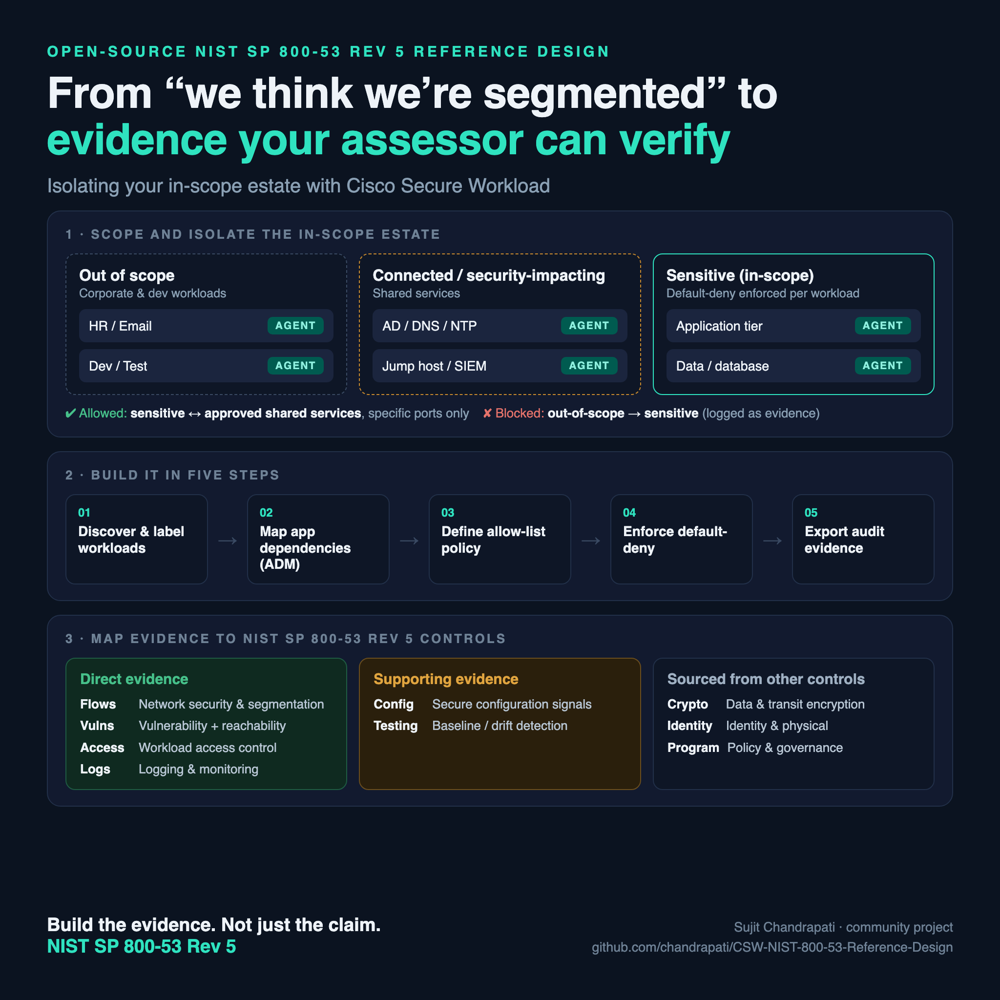

# Cisco Secure Workload — TSA Aviation Cybersecurity Reference Design



**Mapping Cisco Secure Workload to TSA Joint Emergency Amendment 23-01 — for aircraft operators (airlines) under 49 CFR part 1544 and airport operators under part 1542.**

---

## ⚠️ Start here — the requirement text is Sensitive Security Information

**Joint EA 23-01 is SSI** under [49 CFR 1520.5(b)](https://www.ecfr.gov/current/title-49/section-1520.5) — DHS confirmed this in the [Federal Register](https://www.govinfo.gov/content/pkg/FR-2024-04-19/html/2024-08394.htm) (89 FR 28569, n.1). **Its text is not public and is not reproduced in this repo.**

That makes this design structurally different from the [TSA Rail](https://github.com/chandrapati/CSW-TSA-Rail-Reference-Design) and TSA Pipeline designs in this series, which map to a published directive clause by clause. **This one cannot.** It maps CSW capability to what TSA has described **publicly**:

- the **four performance-based measures** in TSA's [March 7, 2023 press release](https://www.tsa.gov/news/press/releases/2023/03/07/tsa-issues-new-cybersecurity-requirements-for-airport-and-aircraft), quoted verbatim;
- the **plan, identification, and annual assessment obligations** recited in the public appellate record of [*Spokane Airport Board v. TSA*](https://media.cadc.uscourts.gov/opinions/docs/2026/01/23-1155-2154795.pdf).

No EA provision numbers appear anywhere in this repo. The capability labels in the mapping section are the document's own descriptive headings. **Your obligations are defined by your TSA-approved security program and Cybersecurity Implementation Plan** — validate every mapping against those, with people cleared to read them.

---

## Airlines are not covered by the rail Security Directive

If you arrived here from the rail design: SD 1580/82-2022-01E applies to freight railroad carriers identified in 49 CFR 1580.101 and other TSA-designated freight and passenger railroads. **It never mentions aviation.** Aviation cyber requirements came through a different instrument entirely.

| | **Aviation** | **Rail** |
|---|---|---|
| Instrument | Joint Emergency Amendment **23-01** | Security Directive **1580/82-2022-01E** |
| Mechanism | Amends the TSA-approved **security program** | Standalone **security directive** |
| Authority | 49 CFR **1542.105(d)**, **1544.105(d)** | 49 U.S.C. **114(l)(2)** |
| TSOB ratification | **Not required** | **Required** beyond 90 days |
| Expiry / renewal | **No fixed expiry**; no annual revision letter | Annual renewal (01 → 01E) |
| Public disclosure | **SSI** | TSA determined the text is **not** SSI |
| Clause-level mapping possible? | **No** | Yes |

Current status: upheld in *Spokane Airport Board v. TSA*, No. 23-1155 (D.C. Cir. **Jan. 20, 2026**). TSA has signalled intent to move to notice-and-comment rulemaking on no fixed timeline — its November 2024 surface NPRM is **not** the aviation vehicle.

---

## What's in this repo

| File | Purpose |
|---|---|
| [**CSW-TSA-Aviation-Reference-Design.md**](./CSW-TSA-Aviation-Reference-Design.md) | The full design — requirement mapping, scope tree, policy set, evidence package, boundary, inspection guide |
| [docs/evidence-checklist.md](./docs/evidence-checklist.md) | Recurring evidence pack, keyed to the public measures |
| [docs/pov-plan.md](./docs/pov-plan.md) | Phased proof-of-value plan for an aviation engagement |

---

## The four measures, and what CSW does about them

| Measure (TSA's public wording, abbreviated) | CSW's contribution |
|---|---|
| **1 — Network segmentation** so operational systems keep running if IT is compromised, *and vice versa* | **Strongest.** Zone model, dependency map from observed flows, enforced default-deny between tiers, denied-connections log proving it operates in **both** directions |
| **2 — Access control** preventing unauthorized access to critical cyber systems | **Partial.** Governs network reachability and administrative paths; contributes nothing to MFA, accounts, or credentials |
| **3 — Continuous monitoring and detection** of threats and anomalies affecting critical systems | **Strong.** Flow telemetry with process attribution, baseline-deviation detection, drift history, SIEM feed |
| **4 — Reduce risk of unpatched systems** using a *risk-based methodology* | **Strong on prioritization.** Reachability + exposure + CISA KEV makes "risk-based" demonstrable; patch deployment is elsewhere |

Plus the obligation that is easy to miss: **annually assess the effectiveness** of the plan. Effectiveness is a different evidence class from implementation, and CSW is unusually good at it — see the evidence section.

---

## The boundary — three exclusions to state out loud

**CSW has no reach into aircraft.** Not avionics, not onboard networks, not in-flight entertainment or connectivity, not flight-deck systems, not the aircraft end of a datalink. There is no partial answer here. For an airline audience this is the fastest way to lose or keep technical credibility.

**CSW does not reach the airport OT layer.** Baggage conveyor controls, access control and camera field devices, airfield lighting, boarding bridges, fuel systems, PLCs. CSW reaches the **server and management tier** behind them. For an airport operator (part 1542) that exclusion covers much of the interesting estate.

**CSW does not reach endpoint fleets.** Crew EFB tablets, kiosks, handhelds, gate workstations. EFB *content distribution servers* are in reach; the devices are not.

What remains is where airline operational disruption actually originates:

| In CSW's reach (ground IT) | Out of reach |
|---|---|
| Dispatch, flight following, movement control | Aircraft avionics and onboard networks |
| Flight planning, weight and balance | Flight-deck and cabin systems |
| Crew scheduling and tracking | Crew / pilot EFB tablets |
| Datalink / ACARS **ground** gateways | The aircraft end of any datalink |
| Reservations, inventory, ticketing | Baggage conveyor controls and PLCs |
| Departure control, check-in, bag reconciliation | Airfield lighting, boarding bridges, fuel |
| MRO, airworthiness, engineering | Access control and CCTV field devices |
| Cargo management and air waybill | Kiosks, handhelds, gate workstations |
| Station / common-use **back end** | Ground support equipment telematics |
| Identity, PKI, logging, patch infrastructure | — |

---

## The zone model

```
Root Scope
└── Aviation-Critical-Cyber-Systems
    ├── Flight-Operations                     (operational core)
    │   ├── Dispatch-and-Flight-Following
    │   ├── Flight-Planning-and-Weight-Balance
    │   ├── Crew-Scheduling-and-Tracking
    │   └── Datalink-Ground-Gateway            (ground side only)
    ├── Passenger-Service-Systems              (business services; disruption-causing)
    │   ├── Reservations-and-Inventory
    │   ├── Departure-Control-and-Checkin
    │   └── Baggage-Reconciliation
    ├── Maintenance-and-Engineering
    │   ├── MRO-and-Airworthiness
    │   └── EFB-Content-Distribution           (servers only)
    ├── Cargo-Operations
    ├── CCS-Supporting-IT
    ├── Station-and-Airport-Facing
    ├── Privileged-Access-Paths
    ├── Corporate-IT                           (default-deny source)
    └── External
        ├── Internet-Edge
        ├── Industry-Networks                  (SITA / ARINC, GDS, interline, codeshare)
        └── Vendor-and-Ground-Handler-Access
```

**`Industry-Networks` is the branch with no surface-mode analog** and the one most often missing from an airline's documentation. SITA and ARINC messaging, GDS connectivity, interline and codeshare feeds are external connections into operational systems — frequently legacy, frequently carrying cleartext, and frequently not governed like internet traffic.

An airport operator's tree keeps the shape but repopulates the critical branch, naming every entry for the **server or management tier**. See §3.4 of the design.

---

## Coverage snapshot

**16 🟢 Direct · 9 🟠 Supporting · 18 ⚪ Evidence Required** across 43 mapped capabilities.

The ⚪ count is the highest in this series, for structural reasons rather than product shortcomings: two of the four measures are predominantly identity and endpoint work, and aviation's excluded estate is larger than rail's. Lead with the 🟢 column and name the ⚪ column before a customer finds it.

### Where CSW is the primary evidence source

- Zone model, interdependency enumeration, and external-connection lists generated from observed behaviour
- Enforced prevention of unauthorized inter-zone communication, with denied connections proving it operates
- **Bidirectional** isolation evidence — the "and vice versa" half of Measure 1 that most evidence sets miss
- Continuous monitoring, baseline deviation, and configuration/software drift on critical systems
- Risk-based patch prioritization: reachability + exposure + CISA KEV
- Compensating-control evidence for workloads that cannot be patched
- **Annual effectiveness** artifacts: simulation reports, denied connections, negative tests, drift history

### Two things worth knowing before a customer conversation

**TSA can designate a system as critical even if you did not identify it.** The public *Spokane* record states TSA's position that this authority is "necessary to prevent gaps." Under-scoping is not a quiet saving — it invites TSA to scope for you. A discovery-driven inventory is the direct hedge, and the design includes a `tsa_designated` label so operator-identified and TSA-designated entries stay distinguishable in your own records.

**Your CIP becomes part of your TSA-approved security program, so changing it needs TSA approval** (49 CFR 1542.105(b)) — with the limit the court noted, that operators "need not secure TSA approval for improvements that do not conflict with their existing security programs." The practical consequence: write the plan at the level of capability and process, not individual rules and ports, or routine CSW tuning turns into a change-approval queue. §8.3 of the design covers this.

---

## What CSW does **not** cover

Multi-factor authentication, account and credential management, shared accounts, domain trust review, patch deployment, encryption, email and web filtering, endpoint and user-behaviour detection, physical security, personnel programmes, CISA incident reporting, the cybersecurity coordinator designation, the Cybersecurity Incident Response Plan, and the Cybersecurity Implementation Plan itself.

**And the boundary unique to aviation:** because the EA is SSI, no vendor document can give you clause-level traceability. That gap closes only inside the customer, by someone with authorized access mapping these capability rows to real provisions and to the approved CIP. Plan for that step in the engagement.

**SSI handling.** Everything you submit to TSA under the EA is SSI, and so is the EA. Treat CSW evidence exports as SSI from the moment they are incorporated into a plan, assessment, or submission, under 49 CFR part 1520. This is stricter than rail, where the directive text itself is openly discussable.

---

## Start here

1. **The SSI constraint** — §1.2 of the design. It governs how this material can honestly be used.
2. **The scope boundary** — §1.3. Aircraft, airport OT, endpoints.
3. **Requirement mapping** — §2, measure by measure.
4. **Scope tree and labels** — §3, including the airport-operator variant in §3.4.
5. **Policy set** — §4, with the bidirectional negative test in §4.2.
6. **Evidence package** — §6, and the implementation-versus-effectiveness distinction.
7. **Boundary** — §7. Read before any customer commitment.
8. **Inspection guide** — §8, including the change-control trap in §8.3.

---

## References & official sources

- TSA, [*TSA issues new cybersecurity requirements for airport and aircraft operators*](https://www.tsa.gov/news/press/releases/2023/03/07/tsa-issues-new-cybersecurity-requirements-for-airport-and-aircraft), March 7, 2023
- DHS, [*Recommendation Regarding Emergency Action in Aviation*](https://www.govinfo.gov/content/pkg/FR-2024-04-19/html/2024-08394.htm), 89 FR 28569, April 19, 2024
- *Spokane Airport Board v. TSA*, [No. 23-1155 (D.C. Cir. Jan. 20, 2026)](https://media.cadc.uscourts.gov/opinions/docs/2026/01/23-1155-2154795.pdf)
- [49 CFR part 1542](https://www.ecfr.gov/current/title-49/subtitle-B/chapter-XII/subchapter-C/part-1542) · [part 1544](https://www.ecfr.gov/current/title-49/subtitle-B/chapter-XII/subchapter-C/part-1544) · [part 1520](https://www.ecfr.gov/current/title-49/subtitle-B/chapter-XII/subchapter-B/part-1520)
- [CISA Known Exploited Vulnerabilities Catalog](https://www.cisa.gov/known-exploited-vulnerabilities-catalog)

---

## Disclaimer

**Draft v1 — pending SME review on both regulatory accuracy and current Cisco product capability.**

Independent engineering work product. Not a Cisco product document, not legal advice, not a compliance certification. **Not endorsed by or affiliated with TSA, DHS, or FAA.**

Built exclusively from the public sources cited above. Does **not** reproduce, paraphrase at clause level, or cite internal provisions of EA 23-01, and makes **no claim** that the four publicly described measures are the complete set of its requirements. Whether a given operator is covered, and whether a revision or successor to EA 23-01 has been issued, are questions for that operator's TSA principal security inspector.

---

*Part of the [CSW Compliance Reference Designs](https://github.com/chandrapati/CSW-Compliance-Reference-Designs) series.*
